# Informe Técnico — Práctica Final Integradora

## Despliegue y Validación de un Stack de Observabilidad Completo

| | |
|---|---|
| **Asignatura** | Taller Observabilidad Infraestructura con Stack Open Source |
| **Estudiante** | Matias Catalan |
| **Fecha** | 29-10-2026 |
| **Repositorio** | https://github.com/Matias2004-cmd/observabilidad-practica-final |

---

## Índice

0. [Resumen y arquitectura](#0-resumen-y-arquitectura)
1. [Paso a paso documentado](#1-paso-a-paso-documentado)
2. [Justificación técnica](#2-justificación-técnica)
3. [Evidencia de funcionamiento](#3-evidencia-de-funcionamiento)
4. [Conclusiones y lecciones aprendidas](#4-conclusiones-y-lecciones-aprendidas)

---

## 0. Resumen y arquitectura

Se implementó, con un único `docker-compose.yml`, un sistema de observabilidad que cubre los tres pilares:

| Pilar | Fuente de datos | Recolección | Almacenamiento | Visualización |
|---|---|---|---|---|
| **Métricas** (hardware) | Host Docker | Node Exporter | Prometheus | Grafana |
| **Métricas** (red) | Agente SNMP simulado (`net-snmp`) | snmp_exporter (módulo `if_mib`) | Prometheus | Grafana |
| **Logs** | App en la nube simulada (JSON) | Promtail (pipeline JSON) | Loki | Grafana |
| **Trazas** | App de microservicios HotROD | OpenTelemetry Collector (OTLP) | Jaeger | Jaeger UI / Grafana |
| **Alertas** | Regla de CPU en Grafana | Grafana Alerting | — | Webhook simulado |

Además, el OTel Collector deriva **métricas RED** (tasa y latencia) a partir de las trazas con el conector `spanmetrics`, lo que une el pilar de trazas con el de métricas en el mismo dashboard.

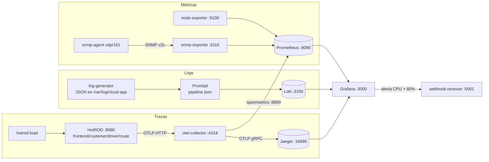

### Estructura del repositorio

```
.
├── docker-compose.yml                  # 14 servicios, 1 red, 4 volúmenes
├── prometheus/
│   ├── prometheus.yml                  # scrape configs (node, snmp con relabeling, otel, loki...)
│   └── rules/recording-rules.yml       # CPU %, Mbps, uso de disco precalculados
├── snmp-agent/                         # agente SNMP simulado (Dockerfile + snmpd.conf)
├── loki/loki-config.yml                # Loki 3 monolítico, TSDB + schema v13
├── promtail/promtail-config.yml        # pipeline JSON -> label level
├── log-generator/generate_logs.py      # simulador de logs cloud en JSON
├── otel-collector/otel-collector-config.yml
├── grafana/
│   ├── provisioning/datasources/       # Prometheus, Loki, Jaeger (UIDs fijos)
│   ├── provisioning/dashboards/
│   ├── provisioning/alerting/          # regla de CPU + contact point webhook + política
│   └── dashboards/dashboard-operativo.json
├── webhook-receiver/receiver.py        # receptor del aviso simulado
├── scripts/validar.ps1                 # validación automática de todos los componentes
└── capturas/                           # evidencias
```

Todo se configura **como código** (provisioning): al ejecutar `docker compose up` el entorno queda funcional sin pasos manuales en la UI, lo que hace la entrega reproducible.

---

## 1. Paso a paso documentado

### 1.1 Requisitos

- Docker Desktop (Windows/macOS) o Docker Engine + plugin Compose v2 (Linux).
- ~4 GB de RAM libres y los puertos `3000, 3100, 4317, 4318, 5001, 8080, 8888, 8889, 9080, 9090, 9100, 9116, 16686` disponibles.

```powershell
docker --version
docker compose version
```

### 1.2 Levantar el entorno

```powershell
git clone <URL-del-repositorio> observabilidad
cd observabilidad
docker compose up -d --build
docker compose ps
```

`--build` construye la imagen del agente SNMP (`snmp-agent/Dockerfile`). El resto son imágenes oficiales con versión fija (no `latest`) para garantizar reproducibilidad.

> 📸 `capturas/01-docker-compose-ps.png` — todos los contenedores en estado `running`.

**Accesos:**

| Componente | URL | Credenciales |
|---|---|---|
| Grafana | http://localhost:3000 | admin / admin (por defecto; Grafana pide cambiarla en el primer inicio de sesión) |
| Prometheus | http://localhost:9090 | — |
| Jaeger UI | http://localhost:16686 | — |
| HotROD | http://localhost:8080 | — |
| Webhook (avisos recibidos) | http://localhost:5001 | — |

### 1.3 Validación automática

```powershell
powershell -ExecutionPolicy Bypass -File scripts\validar.ps1
```

Si se cambiaron las credenciales de Grafana, antes de ejecutar el script se definen `$env:GRAFANA_USER = "<usuario>"` y `$env:GRAFANA_PASSWORD = "<contraseña>"` (así las credenciales no quedan escritas en el repositorio).

El script consulta las APIs de cada componente (targets de Prometheus, consultas PromQL, etiquetas en Loki, servicios en Jaeger, datasources/dashboard/regla en Grafana y avisos en el webhook) e imprime `[OK]` / `[FALLA]` por cada verificación.

> 📸 `capturas/02-validar-ps1.png` — salida completa del script.

### 1.4 Validación manual de cada componente

#### a) Prometheus y Node Exporter

1. Abrir http://localhost:9090/targets → todos los jobs en **UP** (`prometheus`, `node`, `snmp`, `snmp-exporter`, `loki`, `promtail`, `otel-collector`, `otel-spanmetrics`).
2. Comprobar el exporter directamente:
   ```powershell
   curl.exe -s http://localhost:9100/metrics | findstr node_cpu_seconds_total | Select-Object -First 5
   ```
3. En **Graph**, ejecutar la consulta de **uso de CPU**:
   ```promql
   100 - (avg by (instance) (rate(node_cpu_seconds_total{mode="idle"}[1m])) * 100)
   ```

> 📸 `capturas/03-prometheus-targets.png` y `capturas/04-promql-cpu.png`

#### b) Agente SNMP + snmp_exporter

1. Probar el agente desde dentro de su contenedor:
   ```powershell
   # sysName / ifName (1.3.6.1.2.1.31.1.1.1.1) / ifHCInOctets (1.3.6.1.2.1.31.1.1.1.6)
   docker exec snmp-agent snmpget  -v2c -c public localhost 1.3.6.1.2.1.1.5.0
   docker exec snmp-agent snmpwalk -v2c -c public localhost 1.3.6.1.2.1.31.1.1.1.1
   docker exec snmp-agent snmpwalk -v2c -c public localhost 1.3.6.1.2.1.31.1.1.1.6
   ```
   Ejecutar el último comando dos veces **con 10 s de pausa** (`; Start-Sleep 10;`). Si las lecturas son casi simultáneas el valor no cambia, porque `snmpd` mantiene los datos de interfaces en caché unos segundos.

   **Cálculo manual del ancho de banda** con los valores obtenidos (`ifHCInOctets.2`, interfaz `eth0`):

   | | Valor |
   |---|---|
   | Lectura 1 | 1 089 080 228 bytes |
   | Lectura 2 (10 s después) | 1 092 250 934 bytes |
   | Diferencia | 3 170 706 bytes |
   | Ancho de banda | 3 170 706 × 8 ÷ 10 s ÷ 1 000 000 ≈ **2,54 Mbps** |

   Es exactamente lo que automatiza `rate(ifHCInOctets[1m]) * 8 / 1000000` en PromQL, y el resultado coincide con el rango observado en Prometheus (2,4–3,4 Mbps).
2. Probar el exporter (hace el walk SNMP y lo traduce a formato Prometheus):
   ```powershell
   curl.exe -s "http://localhost:9116/snmp?target=snmp-agent:161&module=if_mib&auth=public_v2" | findstr ifHCInOctets
   ```
3. En Prometheus, consulta de **ancho de banda en Mbps** de la interfaz `eth0`:
   ```promql
   rate(ifHCInOctets{job="snmp", ifName="eth0"}[1m]) * 8 / 1000000
   ```
   y la de salida con `ifHCOutOctets`. El agente genera tráfico real por `eth0` (descarga ráfagas de `/metrics` del node-exporter), por lo que el valor oscila aproximadamente entre 0,5 y 5 Mbps.

> 📸 `capturas/05-snmpwalk.png` y `capturas/06-promql-ancho-banda.png`

#### c) Loki + Promtail

1. Ver que el simulador escribe JSON:
   ```powershell
   docker exec log-generator tail -n 3 /var/log/cloud-app/app.log
   ```
2. Ver que Promtail lee el archivo: http://localhost:9080/targets (target `cloud-app` listo).
3. Comprobar que `level` quedó indexado como etiqueta:
   ```powershell
   curl.exe -s http://localhost:3100/loki/api/v1/label/level/values
   # {"status":"success","data":["critical","debug","error","info","warn"]}
   ```
4. En Grafana → **Explore** → datasource **Loki**:
   ```logql
   {job="cloud-app", level="error"}
   ```

> 📸 `capturas/07-promtail-targets.png` y `capturas/08-loki-explore-level.png`

#### d) Grafana: datasources y dashboard

1. **Connections → Data sources**: aparecen *Prometheus* (por defecto), *Loki* y *Jaeger*; en cada uno, **Save & test** devuelve éxito.
2. **Dashboards → SRE → Dashboard Operativo SRE** (también es el home). Contiene:
   - **Resumen**: estado `up` de todos los targets, gauges de CPU y memoria, CPU en el tiempo con línea de umbral.
   - **Red (SNMP)**: ancho de banda de entrada/salida en Mbps, `ifOperStatus` y errores/descartes de interfaz.
   - **Estado del storage**: % de uso por filesystem, espacio libre, **proyección a 24 h** con `predict_linear` e I/O de disco.
   - **Logs (Loki)**: volumen por severidad, % de error, **logs en tiempo real** (refresco 5 s, filtrables con la variable `nivel`) y errores lentos (> 1000 ms).
   - **APM**: latencia p95 y spans/s por servicio derivados de las trazas.

> 📸 `capturas/09-grafana-datasources.png`, `capturas/10a` a `10d` (dashboard en 4 partes)

#### e) Alerta de CPU con Webhook

La regla **"CPU alta en el host"** (carpeta *SRE*) se provisiona automáticamente. Para forzar su disparo se incluye un generador de carga opcional:

```powershell
# 1. Generar carga (un proceso "yes" por cada núcleo)
docker compose --profile stress up -d cpu-stress

# 2. Observar la regla: Normal -> Pending (CPU > 80%) -> Firing (tras 1 minuto)
#    Grafana -> Alerting -> Alert rules

# 3. Ver el aviso recibido por el webhook
docker compose logs -f webhook-receiver
#    o en el navegador: http://localhost:5001

# 4. Detener la carga -> la alerta pasa a "Resolved" y llega un segundo aviso
docker compose --profile stress stop cpu-stress
```

Salida esperada del receptor:

```
======================================================================
[2026-10-29 15:42:10] AVISO RECIBIDO - estado: FIRING
  - CPU alta en el host | severidad=critical | instancia=node-exporter:9100 | firing
    Uso de CPU sobre 80% en node-exporter:9100
======================================================================
```

> 📸 `capturas/11a-alerta-pending.png`, `capturas/11b-alerta-firing.png`, `capturas/12-webhook-recibido.png`, `capturas/13-alerta-resuelta.png`

#### f) OpenTelemetry Collector + Jaeger + HotROD

1. El servicio `hotrod-load` genera 4 pedidos de viaje cada ~3 s; también se puede abrir http://localhost:8080 y pulsar los botones de clientes.
2. Verificar que el collector recibe y exporta spans:
   ```powershell
   docker compose logs --tail 20 otel-collector     # líneas "Traces ... spans: N"
   curl.exe -s http://localhost:8888/metrics | findstr otelcol_receiver_accepted_spans
   curl.exe -s http://localhost:8888/metrics | findstr otelcol_exporter_sent_spans
   ```
3. En http://localhost:16686, **Service = frontend**, **Operation = /dispatch**, **Find Traces**.
4. Abrir una traza y analizar la línea de tiempo (ver sección 3.4).

> 📸 `capturas/14-jaeger-busqueda.png`, `capturas/15-jaeger-traza.png`, `capturas/16-jaeger-mysql-lock.png`, `capturas/17-jaeger-system-architecture.png`

### 1.5 Apagar el entorno

```powershell
docker compose --profile stress down        # conserva los volúmenes (datos)
docker compose --profile stress down -v     # borra también los datos
```

---

## 2. Justificación técnica

### 2.1 Métricas elegidas y consultas PromQL

#### Uso de CPU

```promql
100 - (avg by (instance) (rate(node_cpu_seconds_total{mode="idle"}[1m])) * 100)
```

- `node_cpu_seconds_total` es un **contador** de segundos acumulados por núcleo y modo (`user`, `system`, `idle`, `iowait`...). Un contador no se grafica directamente: se usa `rate()` para obtener cuántos segundos por segundo pasa cada núcleo en ese modo (0 a 1).
- Se mide el **tiempo idle** y se resta de 100 en vez de sumar todos los modos ocupados: es una sola serie por núcleo, más barato y no omite modos (`steal`, `irq`, `softirq`).
- `avg by (instance)` promedia los núcleos para obtener el % global del host, independiente de cuántos núcleos tenga.
- Ventana `[1m]` con `scrape_interval: 15s` → 4 muestras por ventana: suficiente para tolerar un scrape fallido sin suavizar en exceso. Se prefirió `rate` sobre `irate` porque la alerta necesita una señal estable (`irate` solo mira las 2 últimas muestras y es muy ruidoso).

#### Ancho de banda en Mbps (SNMP)

```promql
rate(ifHCInOctets{job="snmp", ifName="eth0"}[1m]) * 8 / 1000000
```

- `ifHCInOctets` / `ifHCOutOctets` (tabla `ifXTable`, IF-MIB) son contadores de **64 bits** de bytes recibidos/enviados. Se eligieron en vez de `ifInOctets` (32 bits) porque éstos dan la vuelta en ~34 s en un enlace de 1 Gbps, lo que produciría cálculos erróneos con un scrape de 15 s.
- `rate()` → bytes/s; `* 8` → bits/s; `/ 1 000 000` → **Mbps** (unidades decimales, como las usan los proveedores de enlaces).
- `rate()` además maneja automáticamente los **resets** del contador (reinicio del equipo).
- Prometheus muestra el aviso *"metric might not be a counter, name does not end in _total"*. Es solo una advertencia del linter: el nombre `ifHCInOctets` viene de la MIB y no sigue la convención `_total` de Prometheus, pero el snmp_exporter lo expone con tipo `counter`, así que `rate()` es correcto.
- `ifName` se obtiene gracias a los `lookups` del módulo `if_mib`, que convierten el índice numérico `ifIndex` en un nombre legible.

#### Por qué SNMP con el patrón "multi-target exporter"

El snmp_exporter no se scrapea como un exporter normal: Prometheus le pide `/snmp?target=snmp-agent:161`. El `relabel_configs` de `prometheus.yml` hace esa traducción y conserva `instance=snmp-agent:161`, de modo que **la etiqueta identifica al equipo de red y no al exporter**. Un solo exporter puede así monitorear cientos de switches/routers.

#### Storage

- `node_filesystem_avail_bytes / node_filesystem_size_bytes` → % de uso. Se usa `avail` (disponible para usuarios no root) en vez de `free`, porque es el espacio que una aplicación puede usar realmente.
- Se filtran explícitamente los puntos de montaje relevantes. En Docker Desktop (WSL2) el node-exporter ve **21 filesystems**, la mayoría montajes internos repetidos de la VM (`/parent-distro/...`, `/usr/lib/wsl`, etc.), que solo meten ruido. Los dos que importan son `/mnt/host/c` (**disco C: de Windows**, el disco físico del host) y `/var/lib` (disco virtual donde Docker guarda imágenes y volúmenes, incluidos los datos de Prometheus y Loki).
- `predict_linear(...[1h], 24*3600)` proyecta el espacio libre a 24 h: permite actuar **antes** de que el disco se llene (alerta predictiva en vez de reactiva), que es justamente el tipo de "incidente silencioso" del escenario.

#### Recording rules

`prometheus/rules/recording-rules.yml` precalcula CPU %, Mbps y uso de disco con nombres `nivel:métrica:operación` (convención de Prometheus). Así la fórmula queda documentada en un único lugar y los dashboards consultan una serie ya calculada.

### 2.2 Logs: pipeline de Promtail y etiquetas

El log simulado imita el formato de los servicios cloud (CloudWatch / Cloud Logging): una línea JSON por evento con campos anidados:

```json
{"timestamp":"2026-10-29T14:03:11.512Z","level":"ERROR","service":"payments",
 "cloud":{"provider":"aws","region":"sa-east-1"},
 "http":{"method":"POST","path":"/api/v1/charge","status":502},
 "latency_ms":1834,"trace_id":"4bf92f35...","message":"Upstream timeout hacia payment-provider"}
```

Etapas del pipeline (`promtail/promtail-config.yml`):

| Etapa | Qué hace | Por qué |
|---|---|---|
| `json` | Extrae `level`, `service`, `cloud.region` (JMESPath anidado), `message`, `trace_id`, `timestamp` | Convierte texto en campos estructurados |
| `drop` | Descarta líneas cuyo mensaje contiene `healthcheck` | Ruido sin valor diagnóstico; reduce almacenamiento y costo |
| `template` | `ERROR` → `error` (`ToLower`) | Normaliza la severidad; Grafana colorea automáticamente `debug/info/warn/error/critical` |
| `labels` | Indexa **`level`**, `service`, `region` | Campos con los que siempre se filtra |
| `structured_metadata` | Guarda `trace_id` sin indexarlo | Consultable, pero sin crear un stream por valor |
| `timestamp` | Usa la hora del evento | El orden y la latencia reflejan cuándo ocurrió, no cuándo se leyó |

**Criterio de cardinalidad.** Loki indexa solo las etiquetas; cada combinación única de etiquetas crea un *stream*. `level` (5 valores) × `service` (4) × `region` (2) = 40 streams como máximo: bajo y estable. En cambio `trace_id` o `latency_ms` tienen un valor distinto por línea: indexarlos crearía millones de streams y degradaría Loki. Por eso esos campos se consultan en tiempo de query con el parser `| json`.

#### Filtros LogQL utilizados

| Consulta | Uso |
|---|---|
| `{job="cloud-app", level=~"$nivel"}` | Panel de logs en tiempo real; el filtro por etiqueta usa el índice, por lo que es muy rápido |
| `sum by (level) (count_over_time({job="cloud-app"}[1m]))` | Convierte logs en métrica: volumen por severidad para ver picos de errores |
| `100 * sum(count_over_time({job="cloud-app", level=~"error\|critical"}[5m])) / sum(count_over_time({job="cloud-app"}[5m]))` | % de error, indicador directo de salud del servicio (SLI) |
| `{job="cloud-app", level=~"error\|critical"} \| json \| latency_ms > 1000 \| line_format "..."` | Primero se reduce con etiquetas (barato) y luego se filtra por un campo no indexado (`latency_ms`); `line_format` reescribe la línea para que sea legible |

**Verificación en Grafana Explore (captura 08):** al desplegar una línea se ven `level=error`, `service`, `region`, `job` y `environment` (etiquetas indexadas por el pipeline), y `trace_id` como structured metadata. También aparece `service_name`, que Loki 3 deriva automáticamente de `service`. El histograma *Logs volume* muestra 1 200 errores en 1 hora, con picos periódicos que corresponden a los incidentes simulados.

El orden importa: **selector de etiquetas → filtro → parser → filtro por campo**. Filtrar primero por etiqueta evita que Loki tenga que parsear todo el volumen.

### 2.3 Alertas y enrutamiento

- **Consulta (A)**: la misma de CPU, como consulta *instant*.
- **Reducción (B)**: `last` → un valor por instancia.
- **Umbral (C)**: `> 80`. Sobre ~80 % de forma sostenida, la latencia de las aplicaciones empieza a degradarse por la cola de ejecución; deja margen para reaccionar antes de la saturación.
- **`for: 1m`**: la condición debe mantenerse 1 minuto (estado *Pending*) antes de pasar a *Firing*; evita avisos por picos momentáneos (*flapping*).
- **Etiquetas `severity=critical`, `team=sre`**: son las que usa la política de notificación para enrutar.
- **Política de notificación**: `group_by: [alertname, instance]` agrupa avisos del mismo problema en un solo mensaje; `group_wait: 10s` (corto para la demo), `repeat_interval: 10m` para no saturar al equipo de guardia. La ruta hija con `team = sre` muestra cómo se enviarían alertas de distintos equipos a distintos canales.
- **Contact point Webhook**: es el integrador más genérico; cualquier sistema (Slack, Teams, PagerDuty, un ITSM, un bot) puede recibir el JSON. El receptor simulado imprime el aviso y lo expone en `http://localhost:5001`. Grafana envía también el aviso de **resolución**.
- **`noDataState: OK`**: al arrancar el stack, Prometheus aún no tiene muestras y Grafana disparaba una alerta `DatasourceNoData` que se enviaba como si fuera un incidente. La falta de datos de CPU no significa CPU alta (y la caída del exporter ya se ve en el panel `up`), así que se trata como estado normal.

### 2.4 Trazas: OpenTelemetry Collector y Jaeger

- **Por qué un collector intermedio** en vez de enviar directo a Jaeger: la aplicación solo conoce el protocolo estándar OTLP; el backend se puede cambiar (Tempo, Zipkin, un SaaS) tocando solo la configuración del collector, sin redeployar la aplicación.
- **Procesadores**: `memory_limiter` (protege al collector ante ráfagas), `resource` (agrega `deployment.environment`), `batch` (agrupa spans: menos llamadas de red).
- **Conector `spanmetrics`**: genera `traces_span_metrics_calls_total` y `traces_span_metrics_duration_milliseconds_bucket` por servicio y operación. Con ellas se calcula el p95 en Grafana: así se detecta la degradación con métricas (barato, con alertas) y se profundiza con trazas (detalle).
- **App de prueba HotROD** (Jaeger): 4 microservicios (`frontend`, `customer`, `driver`, `route`) más una base MySQL y Redis simuladas. Se eligió porque incluye cuellos de botella realistas y conocidos, ideales para practicar el análisis.

---

## 3. Evidencia de funcionamiento

> Las imágenes se encuentran en la carpeta [`capturas/`](capturas/).

### 3.1 Entorno levantado y validado

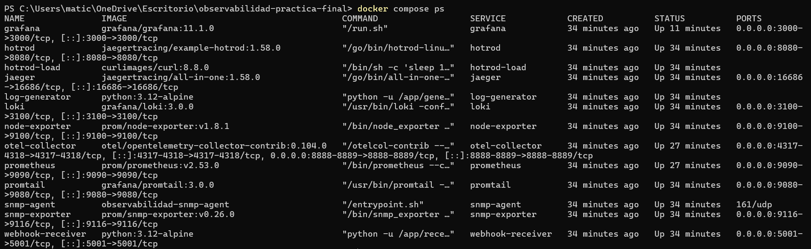
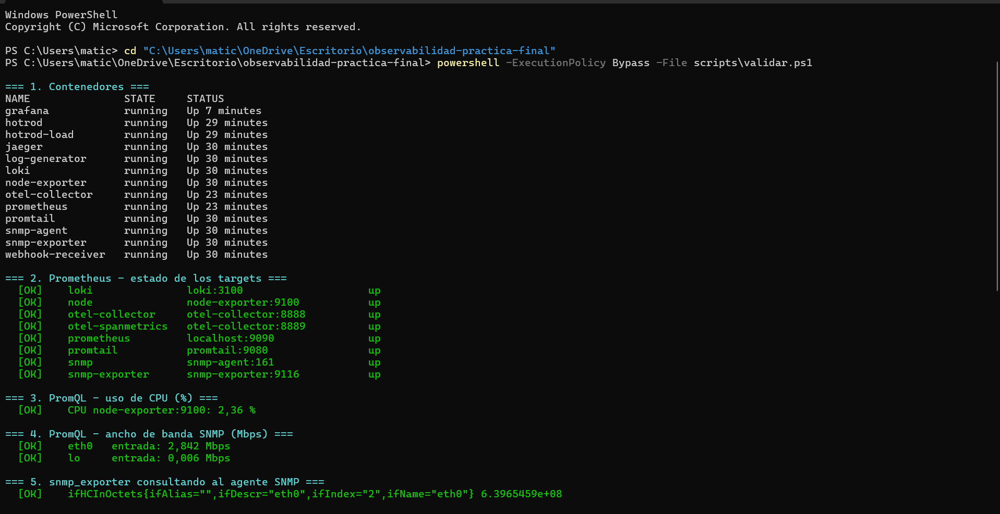
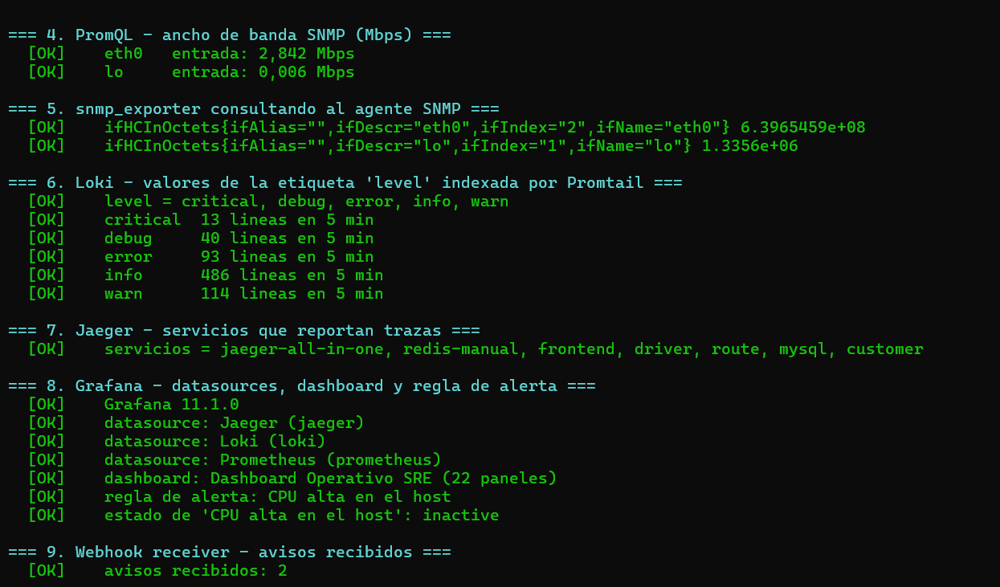
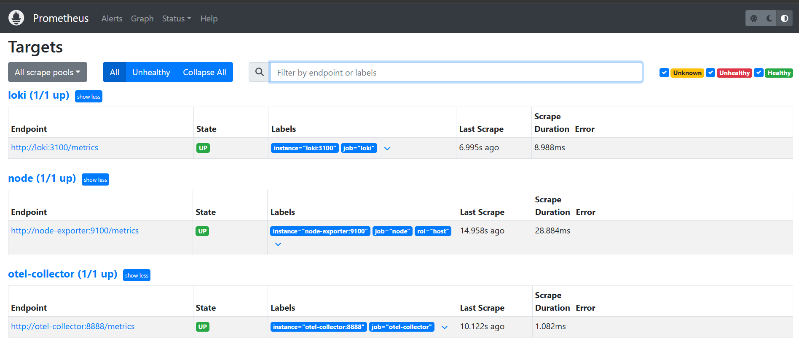
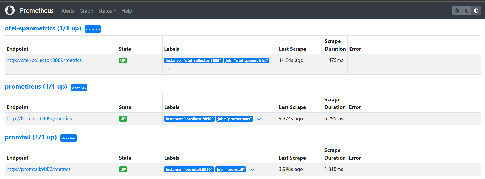
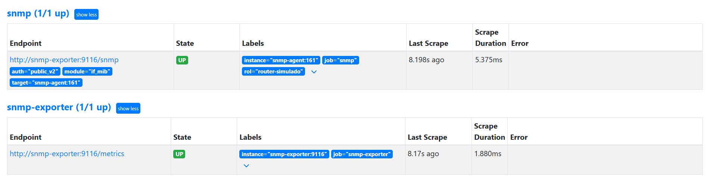

### 3.2 Consultas PromQL

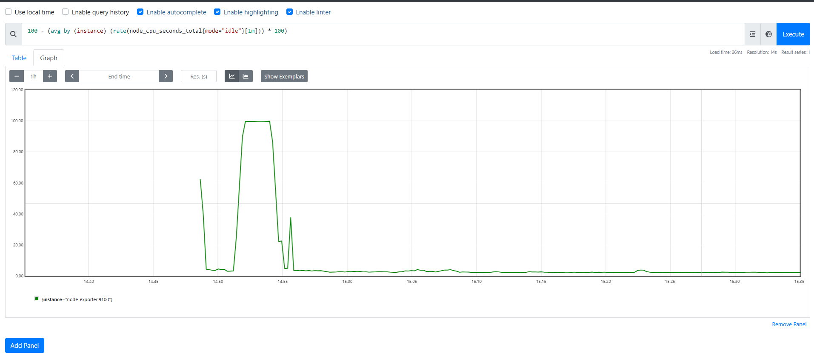
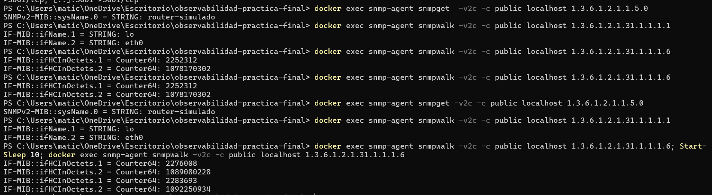
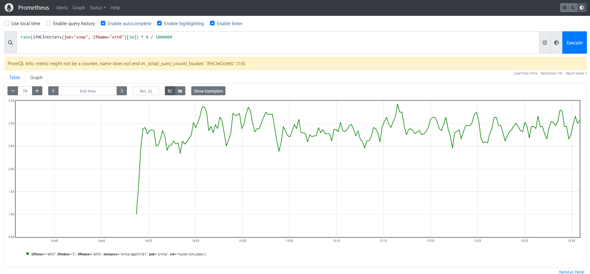
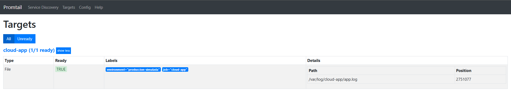

### 3.3 Grafana — Dashboard Operativo y alerta

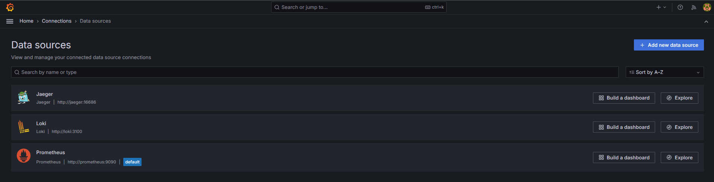
**Dashboard Operativo SRE**, en 4 partes:

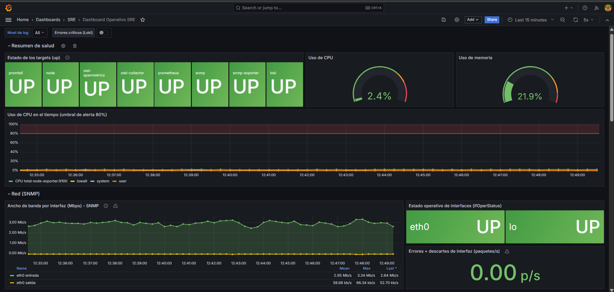
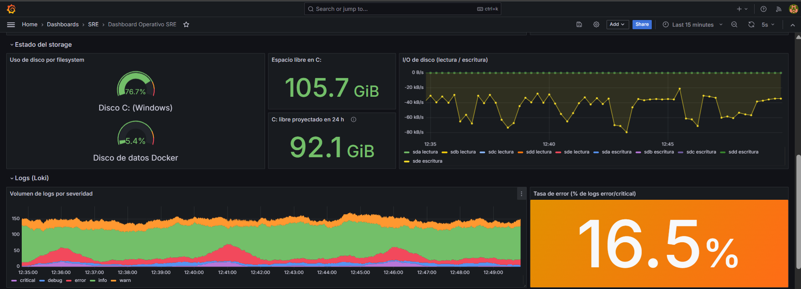
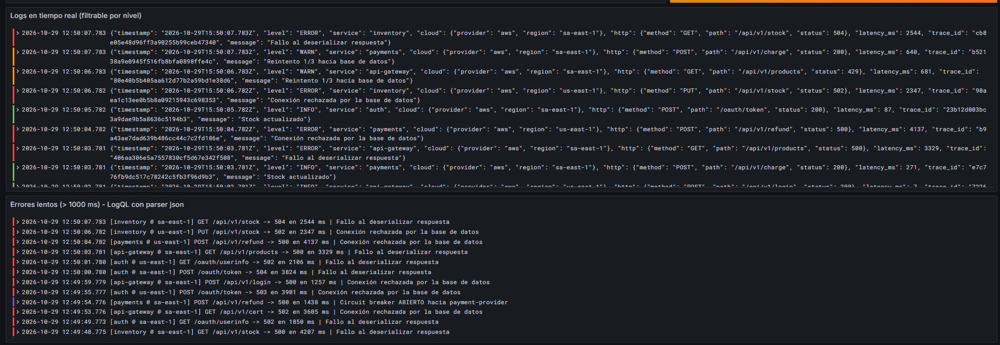
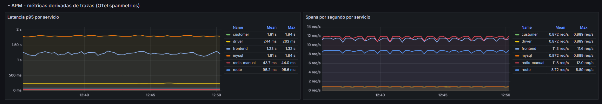
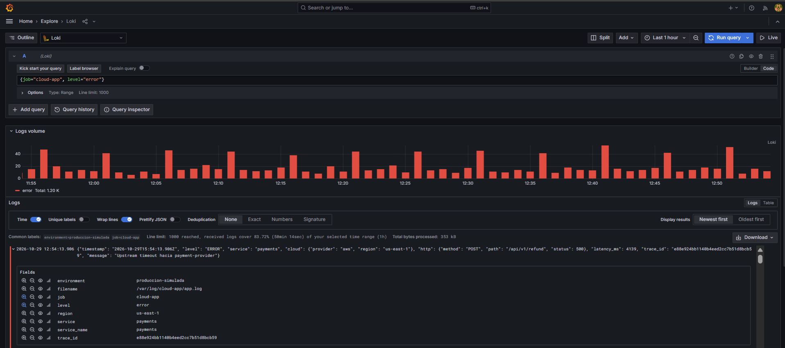
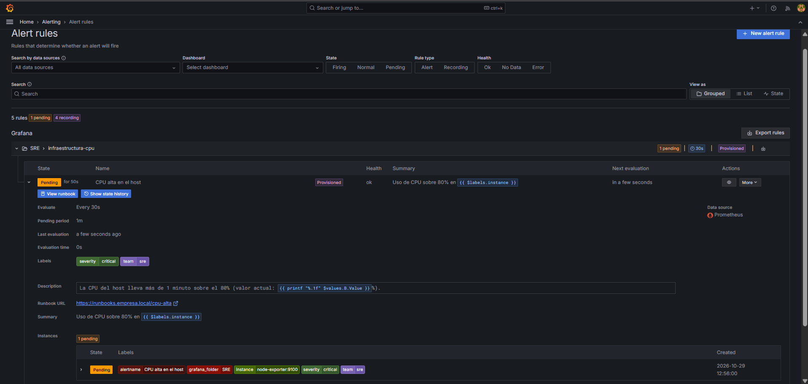
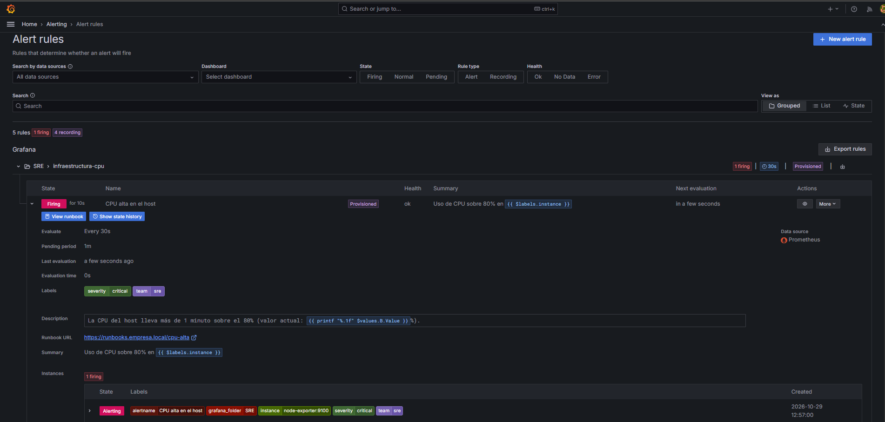
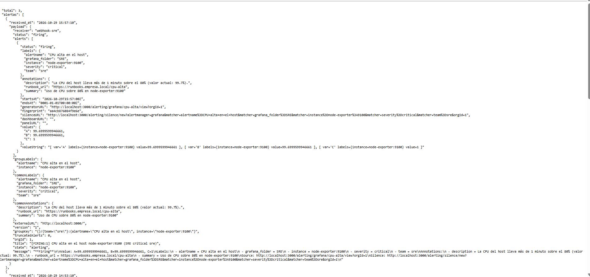
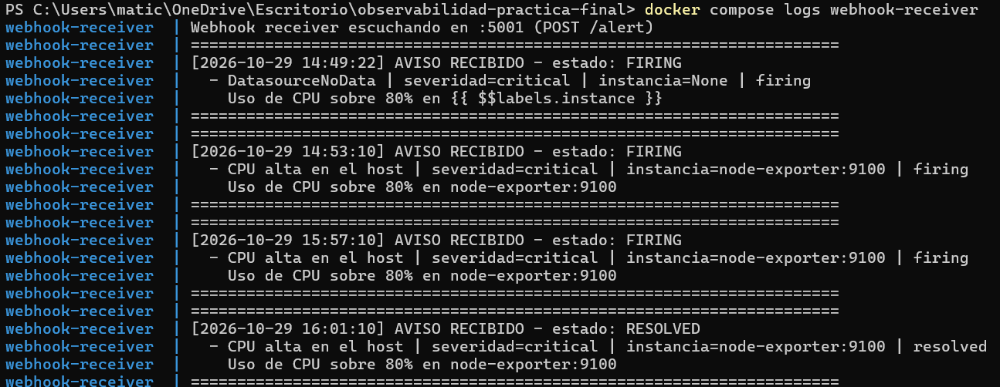
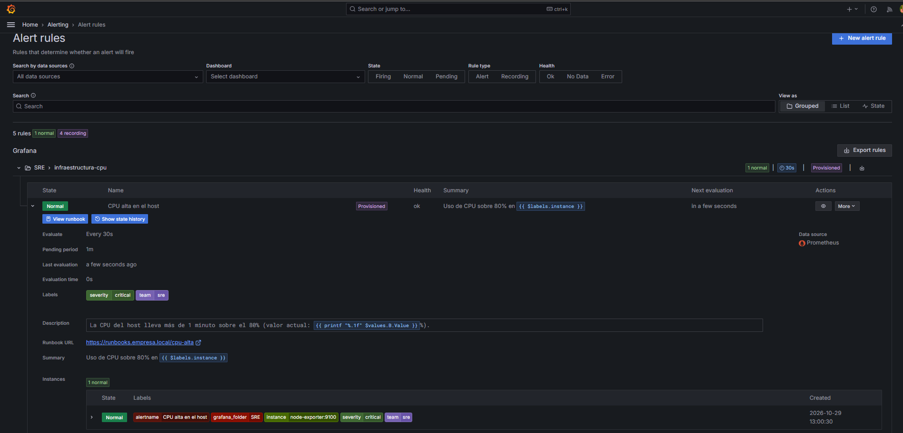

En la captura 12b, el primer aviso (14:49:22 UTC) es el `DatasourceNoData` del arranque, con la plantilla sin renderizar `{{ $$labels.instance }}`. Es la evidencia de los dos problemas descritos en la sección 4 (escape `$$` incorrecto y `noDataState`), ya corregidos: los avisos siguientes muestran la instancia real. Después vienen el FIRING de la primera prueba (14:53:10 UTC), el FIRING de la prueba documentada (15:57:10 UTC) y su **RESOLVED** (16:01:10 UTC), lo que cierra el ciclo de vida completo de la alerta.

**Observaciones:**
- La consulta de CPU muestra el reposo del host (~2–4 %) y la meseta al **100 %** durante la prueba con `cpu-stress` (14:52–14:54), seguida de la vuelta a la normalidad al detenerla.
- El ancho de banda de entrada en `eth0` oscila entre **2,4 y 3,4 Mbps**, de acuerdo con las ráfagas aleatorias (1 a 5 descargas por segundo) del generador de tráfico del agente SNMP; `lo` está excluido del panel.
- **Resumen:** los 8 targets en `UP`, CPU en reposo de 2,4 % y memoria al 21,9 %, ambas bajo los umbrales.
- **Red:** `eth0` y `lo` en estado operativo `UP`, sin errores ni descartes (0,00 p/s). La entrada promedia **2,95 Mbps** (máximo 3,34) y la salida ~59 kbps: el agente descarga mucho más de lo que envía.
- **Storage:** disco C: al **76,7 %** (105,7 GiB libres) y disco de datos de Docker al 5,4 %. La proyección `predict_linear` a 24 h estima 92,1 GiB libres en C:, una tendencia de consumo a vigilar pero sin riesgo inmediato.
- **Logs:** cada 5 minutos el simulador produce un "incidente" de 1 minuto, visible como las "jorobas" rojas (error) del volumen por severidad (12:36, 12:41, 12:46). La tasa de error de los últimos 5 min fue de **16,5 %**. El panel de errores lentos muestra el filtro LogQL funcionando: solo aparecen errores con latencia > 1000 ms, reformateados con `line_format`.
- **Prueba de la alerta** (hora local):

  | Hora | CPU | Estado de la regla | Comentario |
  |---|---|---|---|
  | 12:55:52 | 44,8 % | Normal | `cpu-stress` recién iniciado; `rate[1m]` aún promedia muestras previas |
  | 12:56:12 | 99,6 % | **Pending** | Se supera el umbral de 80 %; empieza a contar `for: 1m` |
  | 12:57:00 | 99,7 % | **Firing** | Tras 1 minuto sostenido se dispara (instancia `Alerting`) |
  | 12:57:10 | 99,7 % | Firing | **El webhook recibe el aviso**: 10 s después, por el `group_wait: 10s` de la política |
  | 13:00:13 | 99,7 % | Firing | Se ejecuta `docker compose --profile stress stop cpu-stress` |
  | 13:00:43 | 36,5 % | **Normal** | La CPU cae bajo el umbral y la regla se resuelve |
  | 13:01:10 | — | Normal | **El webhook recibe el aviso `RESOLVED`** (siguiente ciclo de `group_interval`) |

  El minuto entre *Pending* y *Firing* es exactamente el `for: 1m` configurado, lo que confirma que la regla filtra picos breves, y los 10 s hasta la entrega corresponden al `group_wait`.

  El JSON recibido (captura 12) confirma que el aviso salió por el contact point `webhook-sre`, con las etiquetas de enrutamiento (`team=sre`, `severity=critical`) y la anotación ya renderizada: *"La CPU del host lleva más de 1 minuto sobre el 80% (valor actual: 99.7%)"*. También incluye `silenceURL` y `generatorURL`, que permiten silenciar la alerta o ir a la regla con un clic desde el sistema que recibe el aviso. *(El receptor registra la hora en UTC: 15:57:10 UTC = 12:57:10 hora local.)*

### 3.4 Jaeger — Análisis de una transacción

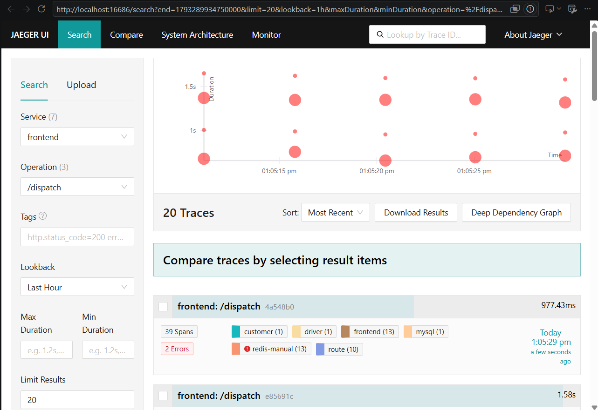
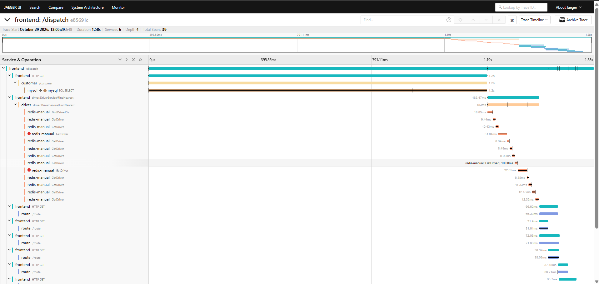
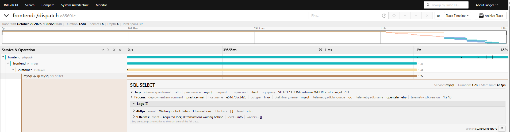
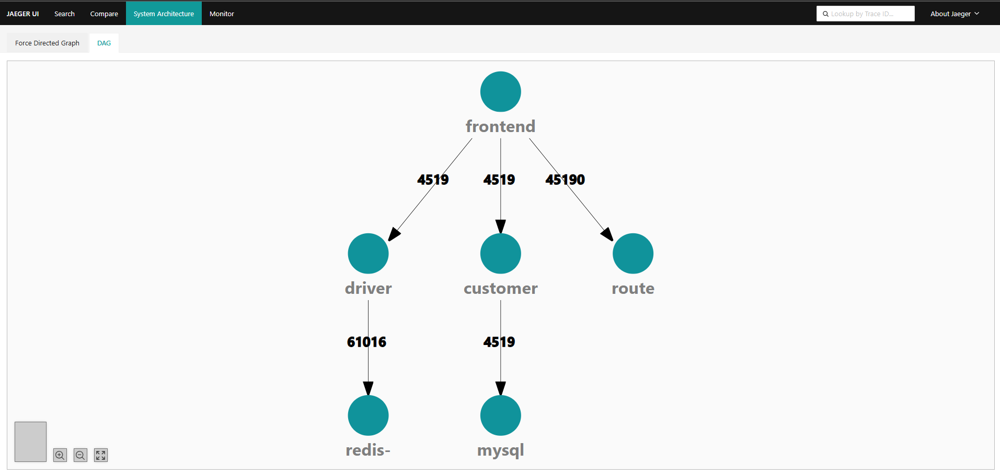

**Detección con métricas (panel APM del dashboard):** en 15 minutos de carga, la latencia p95 promedio por servicio fue de **mysql 1,81 s, customer 1,81 s, frontend 1,23 s, driver 244 ms, route 95 ms y redis 44 ms** (captura 10d). En cambio, por volumen de spans, mysql y customer son los que **menos** reciben (0,87 spans/s, frente a 11,8 de redis): el servicio lento no es el más usado, sino el que espera un recurso compartido. Que `customer` tenga la misma p95 que `mysql` indica que casi todo su tiempo se gasta esperando la base de datos. Esto dice **qué** servicio es lento; la traza dice **por qué**.

**Patrón en la búsqueda (captura 14):** el gráfico de dispersión de Jaeger no muestra latencias repartidas al azar, sino **franjas horizontales** (~0,8 s, ~1,0 s, ~1,4 s y ~1,6 s) que se repiten en cada ráfaga. El generador de carga lanza 4 pedidos simultáneos cada ~3 s, y como el acceso a MySQL está serializado por un lock, cada pedido espera a los anteriores: el primero termina rápido y el cuarto el último. Que haya **4 franjas para 4 pedidos concurrentes** es la firma visual de la contención. Además, cada traza tiene ~39 spans y varias muestran **errores en `redis-manual`** (timeouts simulados).

**Transacción analizada:** `frontend: /dispatch`, trace ID `e85691cb27a825555b7d6a693a1c6052`, **duración total 1 582 ms**, **39 spans** y **2 errores**. Es una de las trazas de la franja más lenta.

Distribución del tiempo en la línea de tiempo:

| Fase | Inicio | Duración | % del total |
|---|---|---|---|
| `customer` → `mysql` SQL SELECT | 0 ms | **1 202,6 ms** | **76 %** |
| `driver` FindNearest (1 `FindDriverIDs` + 12 `GetDriver` en Redis) | 1 203 ms | 183,5 ms | 12 % |
| `route` (10 cálculos de ruta) | 1 387 ms | 195,3 ms | 12 % |

1. **`customer` → `mysql` SQL SELECT (1 202,6 ms, 76 % del total).** Es, con mucha diferencia, el span más largo. La consulta es `SELECT * FROM customer WHERE customer_id=731` y sus logs (captura 16) lo explican todo:
   - a los **0,46 ms**: `Waiting for lock behind 3 transactions`. Esta petición llegó **cuarta** de las 4 concurrentes.
   - a los **936,8 ms**: `Acquired lock; 0 transactions waiting behind`.

   Es decir, **936 ms esperando el lock y solo ~266 ms ejecutando la consulta**. La espera sola es el **59 % de toda la transacción**: el problema no es la base de datos, sino el acceso serializado a ella. **Cuello de botella #1: contención por un lock global.** La latencia crece linealmente con la concurrencia, y eso explica las 4 franjas del gráfico de búsqueda.
2. **`driver` → `redis-manual` (183,5 ms, 12 %).** Tras `FindDriverIDs` (18,9 ms) hay **12 llamadas `GetDriver` estrictamente secuenciales**, cada una empieza cuando termina la anterior (una "escalera" en el Gantt), de ~10 ms cada una. **Dos terminaron en error** (31,0 ms y 32,6 ms, el triple de lo normal), es decir, timeouts que se reintentaron. **Cuello de botella #2: N llamadas en serie que podrían hacerse en paralelo o en una sola (`MGET`/pipeline)**, más una dependencia inestable.
3. **`route` (195,3 ms, 12 %).** Las 10 rutas no se calculan todas a la vez: arrancan **3 en paralelo** (1 387 ms) y las demás van entrando a medida que se libera un hueco (1 419, 1 453, 1 457 ms...). Es el comportamiento de un **pool de 3 workers**. **Cuello de botella #3: paralelismo limitado.** Con un pool de 10, esta fase duraría lo que la ruta más lenta (~72 ms) en vez de 195 ms.

**Grafo de dependencias (captura 17):** Jaeger reconstruye la arquitectura solo a partir de las trazas, sin documentación previa: `frontend` llama a `driver`, `customer` y `route`; `driver` usa `redis` y `customer` usa `mysql`. Los contadores de las aristas confirman el patrón de cada pedido: por cada una de las **4 519** llamadas a `customer`/`mysql`/`driver` hay **45 190 a `route`** (exactamente 10 por pedido) y **61 016 a `redis`** (~13,5 por pedido: 1 `FindDriverIDs` + 12 `GetDriver` + reintentos por timeout). Es la vista que permite ver, de un vistazo, qué servicio amplifica las llamadas.

**Conclusión del análisis:** **el 76 % del tiempo de la transacción se pasa en el span de MySQL, y el 59 % del total es pura espera por el lock**. Otro 12 % son llamadas secuenciales a Redis, y casi nada es lógica de negocio. Optimizaciones propuestas: pool de conexiones en lugar del lock global, `MGET`/pipeline en Redis y aumentar el pool de workers de `route`. Esto es imposible de deducir solo con métricas agregadas: el p95 del panel APM indica **que** `frontend` es lento; la traza muestra **dónde** y **por qué**.

---

## 4. Conclusiones y lecciones aprendidas

**Cómo el stack resuelve el problema.** El escenario pedía blindar la plataforma contra *incidentes silenciosos*. Cada pilar ataca una parte:

- **Métricas (Prometheus + exporters)** responden *¿hay un problema?* de forma barata y continua: CPU, red y disco con historia, umbrales y predicción (`predict_linear`). SNMP extiende la misma herramienta a equipos de red que no pueden ejecutar agentes.
- **Logs (Loki + Promtail)** responden *¿qué pasó?*. Indexar solo etiquetas de baja cardinalidad (`level`, `service`) mantiene Loki liviano, y el parser JSON en tiempo de consulta permite igual filtrar por cualquier campo.
- **Trazas (OpenTelemetry + Jaeger)** responden *¿dónde y por qué es lento?* en un sistema distribuido, algo que ni métricas ni logs aislados muestran.
- **Grafana** los une en un único dashboard y convierte una condición en un **aviso accionable** sin que una persona tenga que estar mirando la pantalla.

**Lecciones aprendidas:**

1. **Todo como código.** Provisionar datasources, dashboard y alertas hace que el entorno sea reproducible con un comando y versionable en Git; configurar a mano en la UI no sobrevive a un `docker compose down -v`.
2. **La cardinalidad es el costo oculto.** La decisión más importante en Loki (y en Prometheus) es qué *no* convertir en etiqueta.
3. **Elegir bien el contador.** Usar `ifHCInOctets` (64 bits) en vez de `ifInOctets` y `rate` en vez de `irate` cambia por completo la exactitud de la medición.
4. **Las alertas deben ser accionables.** `for`, agrupamiento y `repeat_interval` evitan la fatiga de alertas, que es la causa más común de que un aviso real se ignore.
5. **Estándares abiertos evitan el lock-in.** Con OTLP la aplicación no depende de Jaeger; con el Collector se cambia el backend sin tocar código.
6. **Correlacionar pilares.** `spanmetrics` muestra que trazas y métricas no son silos: se detecta con métricas y se diagnostica con trazas.
7. **Problemas reales encontrados durante el despliegue:**
   - **Prerrequisitos del host:** Docker Desktop no se instalaba porque faltaba la característica "Plataforma de máquina virtual"; se resolvió con `wsl --install` como administrador y un **reinicio** (sin reiniciar, `wsl --status` seguía indicando que la virtualización no estaba habilitada).
   - **Plantillas de alerta:** se escapó `$labels` como `$$labels` creyendo que Grafana interpolaría variables de entorno, pero en los archivos de reglas de alerta no lo hace, y el log mostraba `bad character U+0024 '$'`. Se volvió a `$labels`. En cambio, en `docker-compose.yml` sí hay que usar `$$` en los comandos de shell.
   - **Falsa alerta al arrancar:** apareció un `DatasourceNoData` antes de que Prometheus tuviera datos, y se envió al contact point de email por defecto porque la política aún no se había cargado. Se corrigió con `noDataState: OK`.
   - **Nombres de spanmetrics:** en la versión 0.104 del collector el prefijo por defecto venía vacío (`calls_total`, `duration_milliseconds_bucket`) y los paneles APM no mostraban nada. Se fijó `namespace: traces.span.metrics`. Lección: **verificar en `/metrics` el nombre real de una métrica** antes de escribir la consulta.
   - **Filesystems de Docker Desktop:** no existe un montaje `/`; el node-exporter mide la VM de WSL2, así que hubo que identificar qué montajes corresponden a discos reales.
   - **Finales de línea:** los CRLF de Windows rompen los scripts `.sh` dentro de contenedores Linux; se agregó `.gitattributes` y el Dockerfile los normaliza con `sed`.

**Mejoras futuras:** Alertmanager para alertas desde Prometheus con silencios e inhibiciones; Grafana Tempo para correlacionar logs ↔ trazas por `trace_id`; instrumentar la app de logs con OpenTelemetry para que los `trace_id` sean reales; alertas sobre `predict_linear` del disco y sobre la tasa de error de Loki (ruler).
